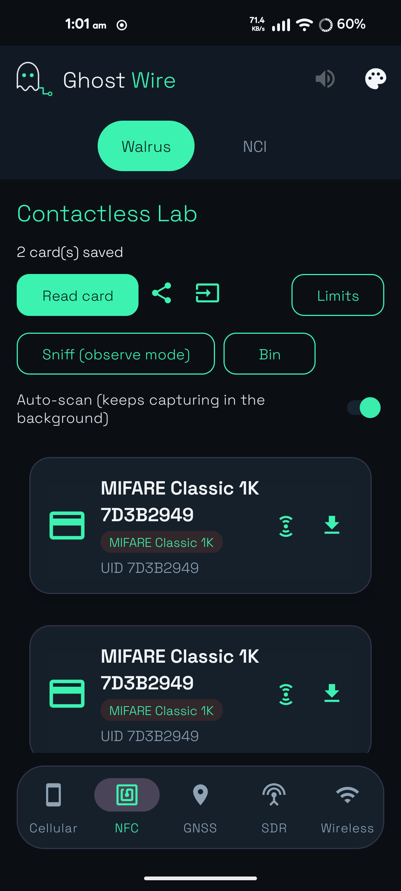
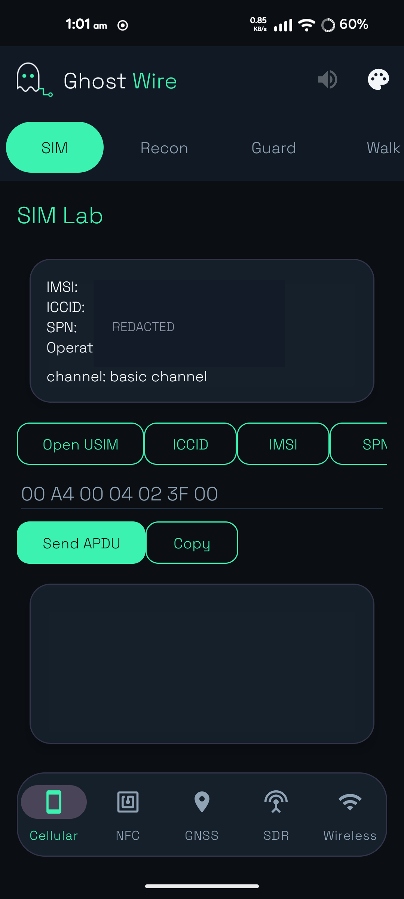
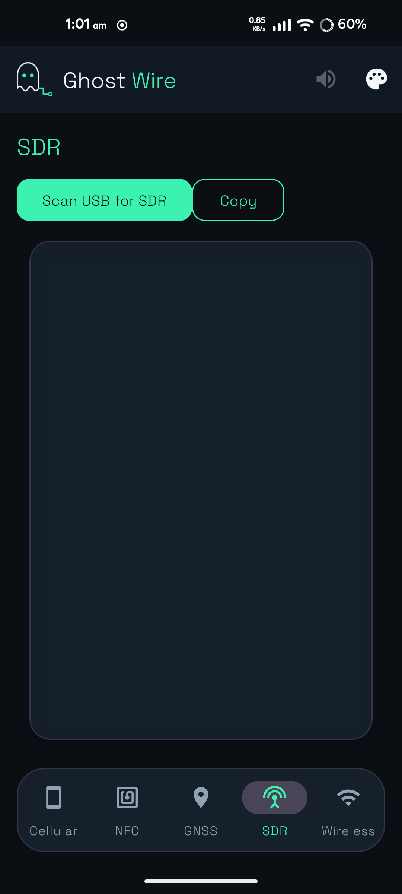

<div align="center">


# GhostWire

**An on-device wireless &amp; RF pentest lab for the OnePlus 9 (AxionOS).**

Cellular · SIM · NFC · GNSS · SDR · Bluetooth — one self-contained app.

[](LICENSE)

-101418)

</div>

---

GhostWire is a single app that pulls the OnePlus 9's radios up to what the
hardware and the AxionOS kernel actually allow — not what the stock SDK
exposes. It is built from source into the ROM as a privileged, platform-signed
system app; a debug-signed APK is also published on every push (see
[Releases](../../releases)).

<div align="center">
&nbsp;&nbsp;&nbsp;
&nbsp;&nbsp;&nbsp;

</div>

## Supported tech

| Domain | Screen | What it does |
|---|---|---|
| **Cellular** | SIM | IMSI / ICCID / SPN / EF reads, logical-channel + USIM AID select (EF_DIR), raw-APDU console with SW decode |
| | Recon | Serving + neighbour cell dump, ARFCN → band + MHz, IMSI/ICCID OSINT, OpenCelliD tower lookup (distance + bearing), timing-advance distance, weighted-centroid multilateration, CSV trace |
| | Guard | IMSI-catcher heuristics: 2G downgrade, no-neighbours, new LAC/TAC, implausible signal |
| | Walk | Wardrive-style cell logging as you move |
| | Map | Serving/neighbour cells and fixes on an offline-capable map (osmdroid) |
| | DIAG | Qualcomm `/dev/diag` NV-item read/write |
| **NFC** | Walrus | Read A/B/F/V, ISO-DEP, MIFARE Classic (dictionary keys) / Ultralight / NDEF; write back to blank/magic tags; HCE emulate (NDEF/Type-4); **Observe Mode** passive polling-frame sniff; GPS-tagged captures, recycle bin, import/export |
| | NCI | Raw NCI console to the controller |
| **GNSS** | Spoof | Mock-location / GNSS spoofing |
| **SDR Labs** | SDR | External USB SDR control (RTL-SDR, HackRF, AirSpy, MSI2500) |
| **Wireless** | BT Scan | Passive BLE advertisement scan |
| | Bluetooth | Adapter + profile state |
| | Wi-Fi | _coming soon_ |

## Requirements

Most screens work from a normal install; the ones below need more.

| Feature | Needs |
|---|---|
| SIM raw APDU / privileged reads | **Platform signature** (system / priv-app) — grants `READ_PRIVILEGED_PHONE_STATE`, `MODIFY_PHONE_STATE`. A debug-signed APK reads only the non-privileged SIM data. |
| DIAG (`/dev/diag`) | **Root** (`su`) **+** the ported `/dev/diag` driver in the AxionOS kernel (`Levion_kernel_OP9`, absent from stock SM8350 kernels) **+** the bundled `ghostwire_diag` helper |
| NFC **Observe Mode** (Sniff) | NXP **SN100U** controller **+** `NXP_EXTENDED_FIELD_DETECT_MODE=0x03` in `/vendor/etc/libnfc-nxp.conf` (shipped by the AxionOS build; not in stock config) |
| NFC read / write / emulate | NFC hardware (present); MIFARE Classic needs an NXP-class controller (SN100U qualifies) |
| Cell OSINT / tower map | `ACCESS_FINE_LOCATION` **+** internet (OpenCelliD) |
| Recon / Guard neighbour cells | `ACCESS_FINE_LOCATION` |
| NFC capture location tag | `ACCESS_FINE_LOCATION` |
| SDR | **External USB SDR** hardware **+** USB-OTG **+** the NetHunter USB-serial / SDR drivers in the AxionOS kernel |
| GNSS Spoof | GhostWire set as the **mock-location app** in Developer options |

> Hard limits the hardware can't cross are listed in-app under **Limits** (125 kHz LF cards, MIFARE nonce attacks, etc.).

## Build & install

**In the ROM (normal path).** GhostWire builds with Soong — it is pinned in
the AxionOS OP9 manifest at `packages/apps/GhostWire` and installed as a
platform-signed privileged system app. No manual steps.

**Standalone APK.** Every push to `main` builds a debug-signed APK and attaches
it to a GitHub [Release](../../releases), with the commit messages since the
last release as the notes. To get a *platform-signed* APK from CI (so the
privileged features work on an AxionOS device), add two repo secrets —
`PLATFORM_PK8_B64` (base64 of `platform.pk8`) and `PLATFORM_X509`
(`platform.x509.pem`) — and the workflow signs with those instead.

Local build:

```sh
# needs JDK 21 + Android SDK (platform 36)
gradle assembleRelease      # -> build/outputs/apk/release/GhostWire-release-unsigned.apk
```

## License

GPLv3 — see [LICENSE](LICENSE). GhostWire reimplements its card-decode logic
clean-room from public NXP datasheets; the bundled MIFARE key dictionary is a
public compilation.
